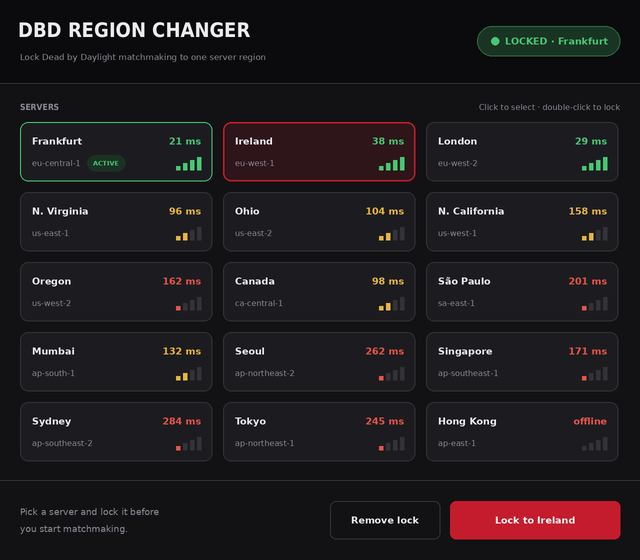
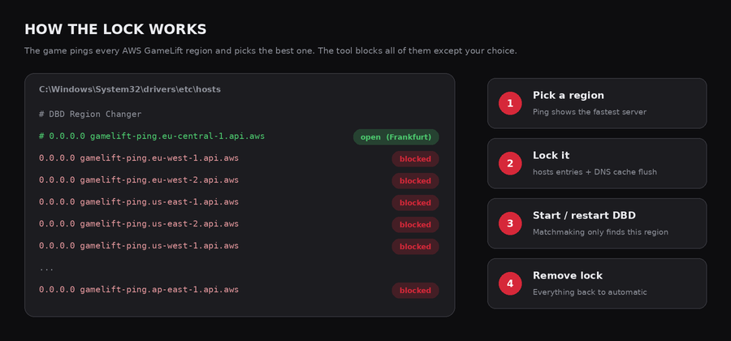

# DBD Region Changer

by **[FGSeRaser](https://github.com/FGSeRaser)**

**Lock Dead by Daylight matchmaking to one server region**: pick a server, click once, play. Shows a live ping to every region so you can see which one is the fastest.



[🇩🇪 Deutsche Beschreibung weiter unten](#deutsch)

---

## Download

Get the latest `.exe` from **[Releases](https://github.com/FGSeRaser/DBD-Region-Changer/releases)**. No installation needed: just start it. Windows asks for administrator rights because the tool edits the hosts file.

**Requirements:** Windows 10 or 11 (.NET Framework 4.8 is already included).

## Features

- **15 server regions**: Frankfurt, Ireland, London, N. Virginia, Ohio, N. California, Oregon, Canada, São Paulo, Mumbai, Seoul, Singapore, Sydney, Tokyo and Hong Kong
- **Live ping every 5 seconds** for each region, with colored signal bars. The fastest server is highlighted.
- **Lock with one click**: select a card and press *Lock to …* (or double-click the card)
- **Remove lock** puts everything back to normal, so the game picks its region automatically again
- **Status badge** in the header: *LOCKED · Frankfurt*, *NO LOCK* or *UNKNOWN STATE* (e.g. if another tool changed the hosts file)
- **Detects the current lock** at start and keeps it up to date while running
- **Restarts itself as administrator** when needed
- **Safe hosts editing**: only its own entries are touched, a read-only hosts file stays read-only, and the DNS cache is flushed so the change works without a reboot
- Dark, compact UI

## How it works



Dead by Daylight measures the ping to every AWS GameLift region (`gamelift-ping.<region>.api.aws`) and searches for matches in the best one.
The tool adds all of these addresses to the Windows **hosts file** and points them to `0.0.0.0`. Only the region you chose stays commented out (`#`), so it is the only one the game can reach.

```text
# DBD Region Changer
# 0.0.0.0 gamelift-ping.eu-central-1.api.aws   ← open (Frankfurt)
0.0.0.0 gamelift-ping.eu-west-1.api.aws        ← blocked
0.0.0.0 gamelift-ping.eu-west-2.api.aws        ← blocked
...
```

The ping in the app is a TCP connection time to `gamelift.<region>.amazonaws.com:443`. It is a good comparison between regions, but it is not the exact in-game ping.

## Usage

1. Start **DBD Region Changer**.
2. Click the region you want to play on (lower ping = better).
3. Press **Lock to …**.
4. **Restart Dead by Daylight** if it was already running.
5. To play normally again, press **Remove lock**.

## Tips & notes

- Matchmaking can take longer in small regions or at night, because the game can't fall back to other servers.
- If the badge shows *UNKNOWN STATE*, press **Remove lock** once and lock again.
- Antivirus or "privacy" tools sometimes protect the hosts file. Allow the change or turn the protection off temporarily.
- This is an unofficial tool and not affiliated with Behaviour Interactive or Amazon Web Services.

## Build from source

Open `DBD Region Changer.sln` in Visual Studio 2019/2022 and press **F5**. It uses .NET Framework 4.8 and needs no NuGet packages.

---

## Deutsch

**Dead by Daylight auf eine Server-Region festlegen**: Server auswählen, einmal klicken, spielen. Ein Live-Ping zu allen Regionen zeigt, welche am schnellsten ist.

- 15 Regionen, Ping alle 5 Sekunden, der schnellste Server wird hervorgehoben
- **Festlegen** mit einem Klick (oder Doppelklick auf die Karte), **Remove lock** stellt alles zurück
- Funktioniert über die Windows-**hosts-Datei**: Alle GameLift-Ping-Adressen außer der gewählten Region werden auf `0.0.0.0` umgeleitet. Danach wird der DNS-Cache geleert, ein Neustart ist nicht nötig.
- Startet sich bei Bedarf selbst mit Administratorrechten neu
- Läuft DBD schon, das Spiel nach dem Festlegen einmal neu starten

**Download:** unter [Releases](https://github.com/FGSeRaser/DBD-Region-Changer/releases). Voraussetzung: Windows 10/11.

---

## Author

Made by **FGSeRaser**. More projects on GitHub: [github.com/FGSeRaser](https://github.com/FGSeRaser)

The app links to the profile in the top-right corner of the header ("by FGSeRaser · GitHub").
